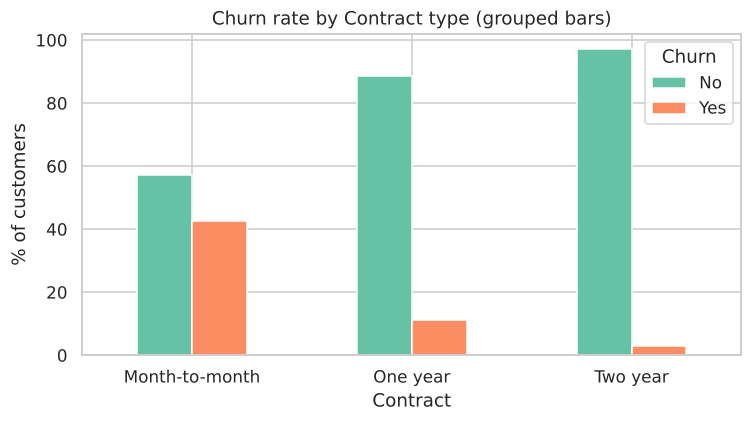
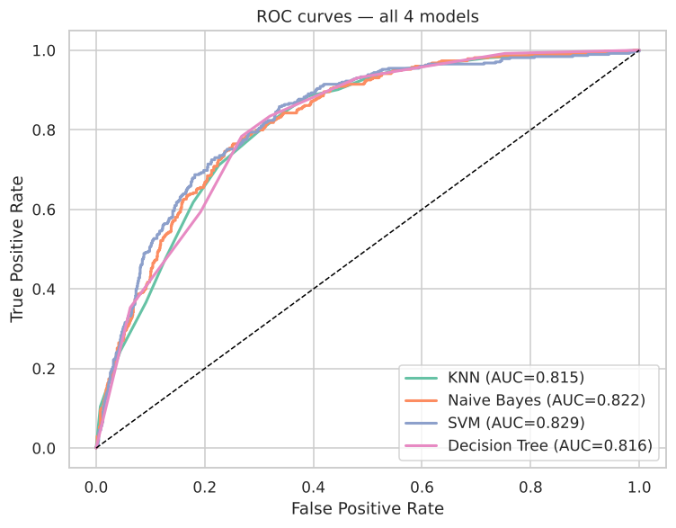
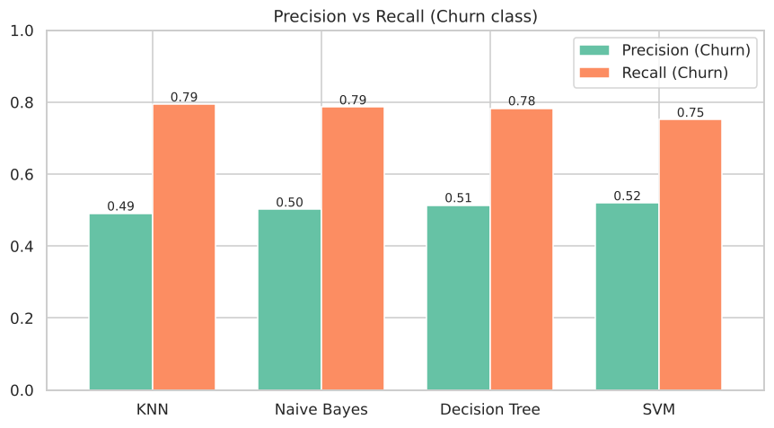
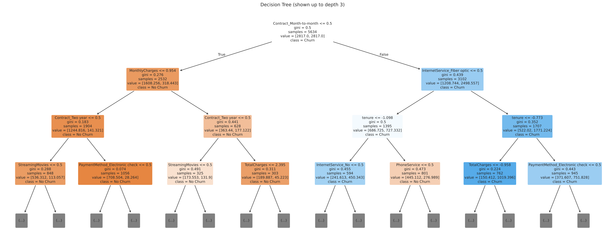

# Telco Customer Churn — Supervised Learning (KNN · Naive Bayes · SVM · Decision Tree)

Red & White Skill Education — Practical Exam, Supervised Learning Set B.

**Goal:** predict which telecom subscribers will churn and recommend which classifier the retention team should deploy.

- **Dataset:** [IBM Telco Customer Churn (Kaggle)](https://www.kaggle.com/datasets/blastchar/telco-customer-churn) — 7,043 rows, 21 columns, target `Churn` (26.5% positive). A copy is included as `WA_Fn-UseC_-Telco-Customer-Churn.csv`.
- **Models:** KNN (k=15), Gaussian NB, SVM RBF (C=0.1), Decision Tree (depth 3).
- **Imbalance:** SMOTE (train only) and `class_weight='balanced'`, compared in Step 5.3.
- **Winner:** Decision Tree — Recall 0.78, F1 0.62, AUC 0.82, interpretable and fast. See [`summary_report.md`](summary_report.md).

## Results (test set, churn class)
| Model | Precision | Recall | F1 | AUC |
|---|---|---|---|---|
| KNN | 0.491 | 0.794 | 0.607 | 0.815 |
| Naive Bayes | 0.502 | 0.786 | 0.613 | 0.822 |
| Decision Tree | 0.514 | 0.783 | 0.621 | 0.816 |
| SVM | 0.519 | 0.751 | 0.614 | 0.829 |

## Screenshots
| | |
|---|---|
|  |  |
|  |  |

## Repository contents
| File | Purpose |
|---|---|
| `CustomerChurn_SupervisedLearning.ipynb` | Fully executed notebook (Steps 1–8) |
| `churn_model.pkl` | Saved sklearn/imblearn pipeline (raw customer row → churn probability) |
| `churn_features.py` | Feature-engineering module used by the pipeline (needed to load the pickle) |
| `summary_report.md` | ~450-word report |
| `requirements.txt` | Dependencies |
| `images/` | All plots |

## How to run
```bash
git clone https://github.com/<your-username>/telco-churn-supervised-learning.git
cd telco-churn-supervised-learning
pip install -r requirements.txt
jupyter nbconvert --to notebook --execute --inplace CustomerChurn_SupervisedLearning.ipynb   # or open in Jupyter
```
Predict with the saved model (run from the repo root so `churn_features` can be imported):
```python
import joblib, pandas as pd
model = joblib.load("churn_model.pkl")
raw = pd.read_csv("WA_Fn-UseC_-Telco-Customer-Churn.csv").drop(columns="Churn").head(5)
print(model.predict_proba(raw)[:, 1])
```

## Video walkthrough
https://drive.google.com/file/d/1SJUg_N0fOGkYGt4BPCUjhHvzKtWhU3uR/view?usp=sharing
