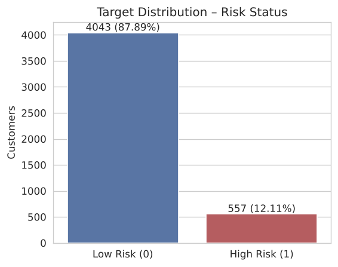
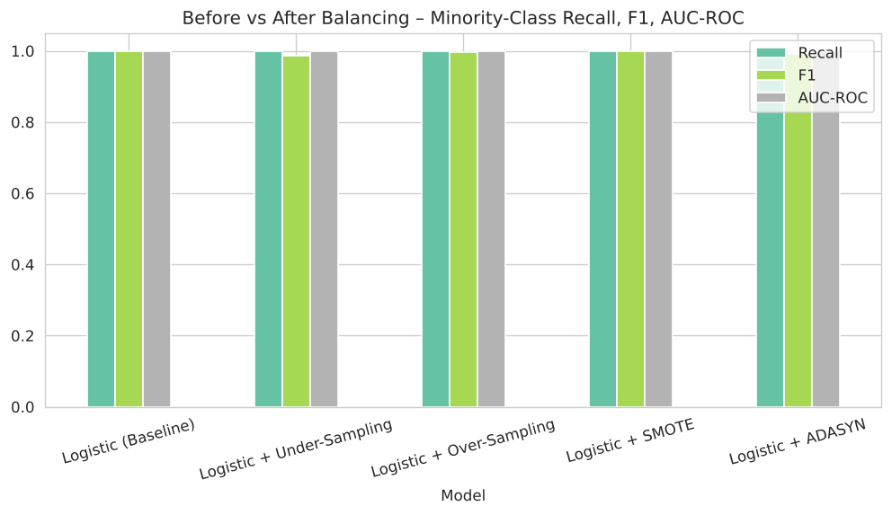
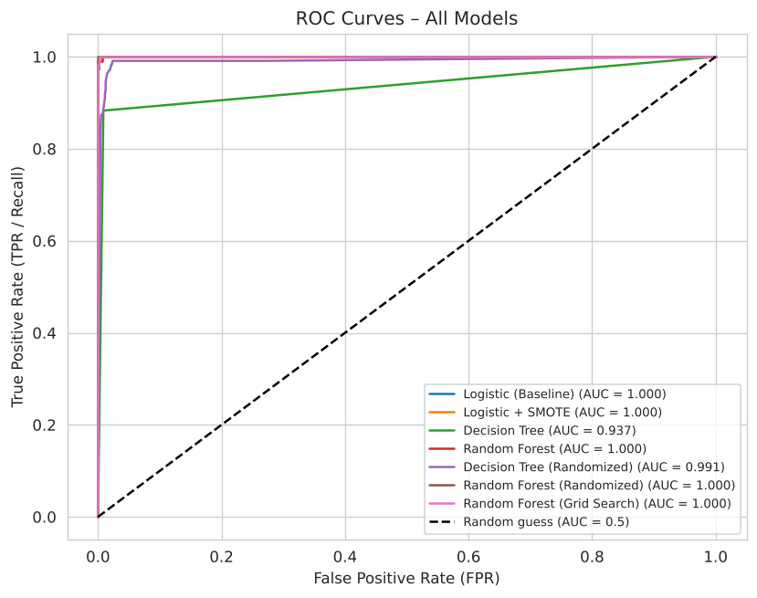
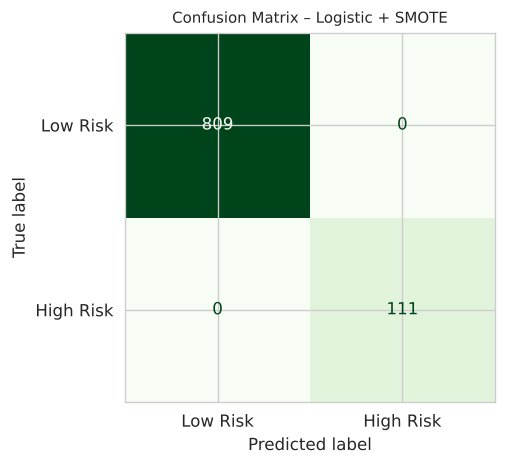

<div align="center">

# 🚨 Risk Alert Classifier

### Early-Warning System to Detect High-Risk Banking Customers


**🌐 Live App:** `PASTE-YOUR-STREAMLIT-URL-HERE`  |  **🎥 Video:** `PASTE-YOUR-VIDEO-LINK-HERE`

</div>

---

## 📑 Table of Contents
1. [🎯 Objective](#-objective)
2. [📝 Problem Statement](#-problem-statement)
3. [📊 Dataset](#-dataset)
4. [📁 Project Structure](#-project-structure)
5. [🔄 Project Workflow](#-project-workflow)
6. [🧪 Methodology (Parts A–H)](#-methodology-parts-ah)
7. [🏆 Results](#-results)
8. [📈 Visualisations](#-visualisations)
9. [💼 Business Interpretation](#-business-interpretation)
10. [🖥️ Streamlit App](#️-streamlit-app)
11. [▶️ How to Run](#️-how-to-run)
12. [☁️ Deployment](#️-deployment)
13. [⚠️ Limitations & Notes](#️-limitations--notes)
14. [✅ Recommendations](#-recommendations)
15. [🛠️ Tech Stack](#️-tech-stack)

---

## 🎯 Objective
Design, evaluate and optimise a **classification system that predicts high-risk customer behaviour**. The project implements multiple classification algorithms, evaluates them with advanced classification metrics, **handles imbalanced data** with sampling techniques, and improves performance with **hyperparameter tuning**.

## 📝 Problem Statement
As a **Data Scientist** for a digital banking platform, build an **early-warning system** that identifies **high-risk customers** who are likely to **default on payments or engage in fraudulent behaviour**.

The dataset is **highly imbalanced** (risky customers are a small minority), so the pipeline must:
- ✅ Accurately identify high-risk customers
- ✅ Handle class imbalance effectively
- ✅ Use appropriate classification metrics (not accuracy alone)
- ✅ Improve performance using hyperparameter tuning

---

## 📊 Dataset
**File:** `Risk_Alert_Classifier_Dataset_4600.csv` — **4,600 customers × 19 columns**

| 🏷️ Group | 📌 Columns |
|---|---|
| 👤 Demographics | `age`, `gender`, `region`, `employment_type`, `annual_income_inr` |
| 💳 Credit behaviour | `credit_score`, `credit_utilization_ratio`, `missed_payments_12m`, `avg_late_payment_days`, `debt_balance_inr`, `cash_advance_count_6m` |
| 🔁 Transaction / activity | `monthly_transaction_count`, `monthly_spend_inr`, `last_transaction_date`, `account_tenure_months`, `complaints_last_6m`, `failed_login_attempts_3m` |
| 🎯 Target | `risk_status` → `0` = Low Risk, `1` = High Risk |
| 🆔 Identifier | `customer_id` (dropped – not a feature) |

**⚖️ Class distribution:** Low Risk ≈ **87.9%** (4,043) | High Risk ≈ **12.1%** (557)

**🕳️ Missing values (2–5%):** `credit_score`, `annual_income_inr`, `credit_utilization_ratio`, `employment_type`, `age`, `monthly_spend_inr`, `region`

---

## 📁 Project Structure
```
Risk_Alert_Classifier/
│
├── 📓 Risk_Alert_Classifier.ipynb          # Complete notebook (Parts A–H)
├── 📄 Risk_Alert_Classifier_Dataset_4600.csv
├── 🖥️ app.py                               # Streamlit app
├── 🧩 utils.py                             # Helper functions for the app
├── 🤖 model.pkl                            # Final model + scaler + imputer + threshold
├── 📚 Theory_Concepts.pdf                  # Theory concepts with definitions
├── 📦 requirements.txt                     # Dependencies
├── 📘 README.md                            # This file
│
├── 🖼️ images/                              # All labelled charts (PNG)
│   ├── 01_target_distribution.png
│   ├── 02_missing_values.png
│   ├── 03_cm_baseline.png
│   ├── 04_class_counts_after_sampling.png
│   ├── 05_balancing_comparison.png
│   ├── 06_overfitting_check.png
│   ├── 07_rf_feature_importance.png
│   ├── 08_tuned_vs_untuned.png
│   ├── 09_roc_curves.png
│   └── 10_cm_final_model.png
│
└── 📊 results/
    ├── model_comparison.csv
    ├── imbalance_comparison.csv
    └── final_config.json
```

---

## 🔄 Project Workflow
```
Raw Data → Cleaning & Encoding → Stratified Split → Scaling + KNN Imputer
      → Baseline (Logistic) → Balancing (Under / Over / SMOTE / ADASYN)
      → Decision Tree & Random Forest → Randomized Search → Grid Search
      → ROC & Cross-Validation → Final Model + Threshold → Streamlit App
```

---

## 🧪 Methodology (Parts A–H)

### 🧠 Part A – Conceptual Understanding
Logistic Regression, classification metrics, Type-I / Type-II errors, Precision / Recall / F1 / TPR / FPR, AUC-ROC and the problem of imbalanced data (answered in the notebook and in `Theory_Concepts.pdf`).

### 🧪 Part B – Data Preparation
- 🆔 Removed `customer_id`; converted `last_transaction_date` → `days_since_last_txn` (recency)
- 🔤 Missing `region` / `employment_type` → **"Unknown"** category, then one-hot encoding
- ✂️ **Stratified 80/20 train–test split** (class ratio preserved)
- 📏 `StandardScaler` + 🧩 **KNN Imputer (k = 5)** for multivariate imputation — **fitted on train only** (no data leakage)

### 📊 Part C – Baseline Model
**Logistic Regression** with confusion matrix, accuracy, precision, recall, F1, and Type-I (FP) / Type-II (FN) error analysis.

### ⚖️ Part D – Handling Imbalanced Data
Applied to the **training set only**: 🔻 Under-Sampling · 🔺 Over-Sampling · 🧬 **SMOTE** · 🎯 **ADASYN** — compared by minority-class Recall, F1 and AUC-ROC.

### 🌳 Part E – Tree-Based Models
🌲 Decision Tree and 🌳 Random Forest, train-vs-test **overfitting analysis**, feature importance.

### 🔧 Part F – Hyperparameter Tuning
🎲 **RandomizedSearchCV** (Decision Tree + Random Forest, scoring = F1, 5-fold stratified CV) → 🔍 **GridSearchCV** on the best model → tuned vs untuned comparison.

### 📈 Part G – Evaluation & ROC
ROC curves and AUC for all models, **5-fold cross-validation**, final model chosen by the business rule **"minimise false negatives"** (highest CV recall with precision ≥ 0.40). The decision threshold is chosen on out-of-fold training predictions only.

### 🧾 Part H – Reporting
Final report, saved model, charts, tables and Streamlit app.

---

## 🏆 Results

### ⚖️ Impact of balancing (Logistic Regression, test set)
| Model | Precision | Recall | F1 | AUC-ROC |
|---|:---:|:---:|:---:|:---:|
| Baseline | 1.000 | 1.000 | 1.000 | 1.000 |
| + Under-Sampling | 0.974 | 1.000 | 0.987 | 1.000 |
| + Over-Sampling | 0.991 | 1.000 | 0.996 | 1.000 |
| + SMOTE | 1.000 | 1.000 | 1.000 | 1.000 |
| + ADASYN | 0.982 | 1.000 | 0.991 | 1.000 |

### 🌳 Tree models (test set)
| Model | Precision | Recall | F1 | AUC-ROC | FN |
|---|:---:|:---:|:---:|:---:|:---:|
| Decision Tree (untuned) | 0.933 | 0.883 | 0.907 | 0.937 | 13 |
| Decision Tree (Randomized) | 0.899 | 0.964 | 0.930 | 0.991 | 4 |
| Random Forest (untuned) | 1.000 | 0.991 | 0.995 | 1.000 | 1 |
| Random Forest (Grid Search) | 0.991 | 0.991 | 0.991 | 1.000 | 1 |

### 🔁 5-fold cross-validation (train set) – used to pick the final model
| Model | Precision | Recall | F1 | AUC-ROC | FN | FP |
|---|:---:|:---:|:---:|:---:|:---:|:---:|
| Logistic (Baseline) | 0.989 | 0.971 | 0.980 | 0.999 | 13 | 5 |
| **Logistic + SMOTE** ⭐ | 0.969 | **0.987** | 0.978 | 0.999 | **6** | 14 |
| Decision Tree (Randomized) | 0.907 | 0.899 | 0.903 | 0.970 | 45 | 41 |
| Random Forest (Grid Search) | 0.982 | 0.960 | 0.971 | 0.998 | 18 | 8 |

### 🥇 Final model
**Logistic Regression + SMOTE** — best cross-validated recall (fewest missed risky customers) with high precision, fast and easy to explain.

> 🔑 **Top risk drivers:** average late-payment days, missed payments (12 m), credit utilisation, credit score, cash-advance count.

> 📝 Exact numbers may differ slightly when you re-run the notebook (random sampling / library versions).

---

## 📈 Visualisations
| | |
|---|---|
|  |  |
|  |  |

---

## 💼 Business Interpretation
| Error | Meaning | Business impact |
|---|---|---|
| ❌ **False Negative (Type-II)** | Risky customer predicted Low Risk | 💸 Missed default / fraud → **costliest error** |
| ⚠️ **False Positive (Type-I)** | Safe customer flagged High Risk | 🕒 Extra manual review, small customer friction → cheaper |

➡️ Therefore the model prioritises **Recall** and accepts a few extra false alarms.

---

## 🖥️ Streamlit App
- 🔍 **Predict tab:** enter customer details → get High-Risk probability and 🚨 / ✅ alert
- 🎚️ Adjustable **alert threshold** slider in the sidebar
- 📊 **Model performance tab:** comparison table, ROC curves and confusion matrix

---

## ▶️ How to Run
```bash
# 1️⃣ Install dependencies
pip install -r requirements.txt

# 2️⃣ Run the notebook (Run All) – regenerates model.pkl, images/ and results/
jupyter notebook Risk_Alert_Classifier.ipynb

# 3️⃣ Launch the app
streamlit run app.py
```

## ☁️ Deployment
1. 📤 Push this folder to a **public GitHub repository**
2. 🌐 Open https://share.streamlit.io → **New app** → select repo, branch `main`, main file `app.py`
3. 🔗 Copy the live URL into the top of this README

---

## ⚠️ Limitations & Notes
- 🧼 The dataset is **very cleanly separable**, so many models score close to 100%. Real banking data is usually noisier — expect lower scores in production and validate on fresh data.
- 🎯 Resampling is applied **only to training data**; the test set is never resampled.
- 🔒 All scaling / imputation is fitted on training data only (no leakage).
- 🧪 Model selection uses **cross-validation**, not the test set.

## ✅ Recommendations
1. 🚀 Deploy **Logistic + SMOTE** as the scoring engine; keep Random Forest as a challenger.
2. 👀 Send flagged customers to **manual review** rather than blocking automatically.
3. 📅 Monitor recall, precision and High-Risk share **monthly**; retrain on data drift.
4. 🧹 Reduce missing data in credit score, income and utilisation at the source.

## 🛠️ Tech Stack
🐍 Python · 🐼 pandas · 🔢 NumPy · 🤖 scikit-learn · ⚖️ imbalanced-learn · 📊 matplotlib / seaborn · 🖥️ Streamlit · 💾 joblib

---
<div align="center">⭐ Built as part of the **Risk Alert Classifier** project ⭐</div>

Link :
https://drive.google.com/file/d/1yjWdIGtHIP4rAq0fjlBGi1YFhc9W6r1f/view?usp=sharing
